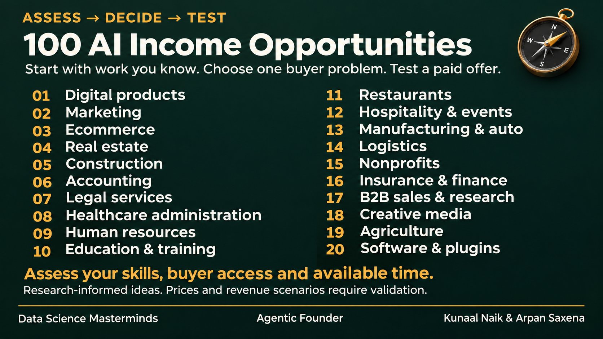

# AI Income Opportunities — visual library

**Data Science Masterminds · Agentic Founder**
**Kunaal Naik & Arpan Saxena**

A decision-oriented companion to the [research project](../../research/100-ai-income-opportunities/README.md). Start with existing skills and reachable buyers, choose a chapter, assess an offer, then test whether someone will pay.



## Open the collection

- [Master index image](00-master-index.png)
- [Local searchable gallery](gallery.html): download or clone the repository and open this file in your browser. GitHub displays its HTML source; this is not a hosted website.
- [Master decision guide](../../research/100-ai-income-opportunities/MASTER-INDEX.md)
- [Chapter decision guide](../../research/100-ai-income-opportunities/CHAPTER-INDEX.md)
- [Economics and capacity](../../research/100-ai-income-opportunities/ECONOMICS.md)

## Chapters

Each chapter contains an index image followed by five topic images. Topic IDs match the research catalog.

| Chapter | Topic IDs | Images and review notes | Decision guide |
|---|---|---|---|
| 01. Digital products and professional knowledge | AI-001–AI-005 | [Chapter files](ch01/README.md) · [Index PNG](ch01/00-chapter-index.png) | [Assess options](../../research/100-ai-income-opportunities/chapters/01-index.md) |
| 02. Marketing and communications | AI-006–AI-010 | [Chapter files](ch02/README.md) · [Index PNG](ch02/00-chapter-index.png) | [Assess options](../../research/100-ai-income-opportunities/chapters/02-index.md) |
| 03. Ecommerce and retail | AI-011–AI-015 | [Chapter files](ch03/README.md) · [Index PNG](ch03/00-chapter-index.png) | [Assess options](../../research/100-ai-income-opportunities/chapters/03-index.md) |
| 04. Real estate and property management | AI-016–AI-020 | [Chapter files](ch04/README.md) · [Index PNG](ch04/00-chapter-index.png) | [Assess options](../../research/100-ai-income-opportunities/chapters/04-index.md) |
| 05. Construction and home services | AI-021–AI-025 | [Chapter files](ch05/README.md) · [Index PNG](ch05/00-chapter-index.png) | [Assess options](../../research/100-ai-income-opportunities/chapters/05-index.md) |
| 06. Accounting and bookkeeping | AI-026–AI-030 | [Chapter files](ch06/README.md) · [Index PNG](ch06/00-chapter-index.png) | [Assess options](../../research/100-ai-income-opportunities/chapters/06-index.md) |
| 07. Legal services | AI-031–AI-035 | [Chapter files](ch07/README.md) · [Index PNG](ch07/00-chapter-index.png) | [Assess options](../../research/100-ai-income-opportunities/chapters/07-index.md) |
| 08. Healthcare and dental administration | AI-036–AI-040 | [Chapter files](ch08/README.md) · [Index PNG](ch08/00-chapter-index.png) | [Assess options](../../research/100-ai-income-opportunities/chapters/08-index.md) |
| 09. Recruiting and human resources | AI-041–AI-045 | [Chapter files](ch09/README.md) · [Index PNG](ch09/00-chapter-index.png) | [Assess options](../../research/100-ai-income-opportunities/chapters/09-index.md) |
| 10. Education and workforce training | AI-046–AI-050 | [Chapter files](ch10/README.md) · [Index PNG](ch10/00-chapter-index.png) | [Assess options](../../research/100-ai-income-opportunities/chapters/10-index.md) |
| 11. Restaurants and food businesses | AI-051–AI-055 | [Chapter files](ch11/README.md) · [Index PNG](ch11/00-chapter-index.png) | [Assess options](../../research/100-ai-income-opportunities/chapters/11-index.md) |
| 12. Hospitality, tourism and events | AI-056–AI-060 | [Chapter files](ch12/README.md) · [Index PNG](ch12/00-chapter-index.png) | [Assess options](../../research/100-ai-income-opportunities/chapters/12-index.md) |
| 13. Manufacturing and automotive operations | AI-061–AI-065 | [Chapter files](ch13/README.md) · [Index PNG](ch13/00-chapter-index.png) | [Assess options](../../research/100-ai-income-opportunities/chapters/13-index.md) |
| 14. Logistics and wholesale distribution | AI-066–AI-070 | [Chapter files](ch14/README.md) · [Index PNG](ch14/00-chapter-index.png) | [Assess options](../../research/100-ai-income-opportunities/chapters/14-index.md) |
| 15. Nonprofits and membership associations | AI-071–AI-075 | [Chapter files](ch15/README.md) · [Index PNG](ch15/00-chapter-index.png) | [Assess options](../../research/100-ai-income-opportunities/chapters/15-index.md) |
| 16. Insurance and financial-service operations | AI-076–AI-080 | [Chapter files](ch16/README.md) · [Index PNG](ch16/00-chapter-index.png) | [Assess options](../../research/100-ai-income-opportunities/chapters/16-index.md) |
| 17. B2B sales and professional research | AI-081–AI-085 | [Chapter files](ch17/README.md) · [Index PNG](ch17/00-chapter-index.png) | [Assess options](../../research/100-ai-income-opportunities/chapters/17-index.md) |
| 18. Creative media and localization | AI-086–AI-090 | [Chapter files](ch18/README.md) · [Index PNG](ch18/00-chapter-index.png) | [Assess options](../../research/100-ai-income-opportunities/chapters/18-index.md) |
| 19. Agriculture and rural businesses | AI-091–AI-095 | [Chapter files](ch19/README.md) · [Index PNG](ch19/00-chapter-index.png) | [Assess options](../../research/100-ai-income-opportunities/chapters/19-index.md) |
| 20. Software, plugins and AI implementation | AI-096–AI-100 | [Chapter files](ch20/README.md) · [Index PNG](ch20/00-chapter-index.png) | [Assess options](../../research/100-ai-income-opportunities/chapters/20-index.md) |

## How to decide

Each topic gives a fit cue, a defined deliverable, a small validation step and a constraint. Prices are explicitly labeled hypotheses. Do not treat an image as proof of demand, validated pricing, guaranteed income or professional authorization.

The research retains the sources and detailed assumptions. The image is a teaching aid, not a replacement for the research card. Regulated work requires appropriate competence and review.

## Production and verification

The collection target is **121 PNGs: one master index, 20 chapter indexes and 100 topic images**. Final completeness and native dimensions are recorded in [verification.json](verification.json). Chapter manifests retain exact generation prompts and visual review notes. Files are flattened images, not editable PowerPoint slides.

To rebuild the gallery and check the complete collection:

```bash
python assets/ai-income/build_gallery.py --require-complete
```

The gallery supports industry, technical-entry, business-model and free-text filters. Filter logic and a 390-pixel mobile viewport were checked with Chromium/Playwright. Its explanatory text remains accessible as HTML even when slide images are small on mobile; click an image to inspect it at native size.
